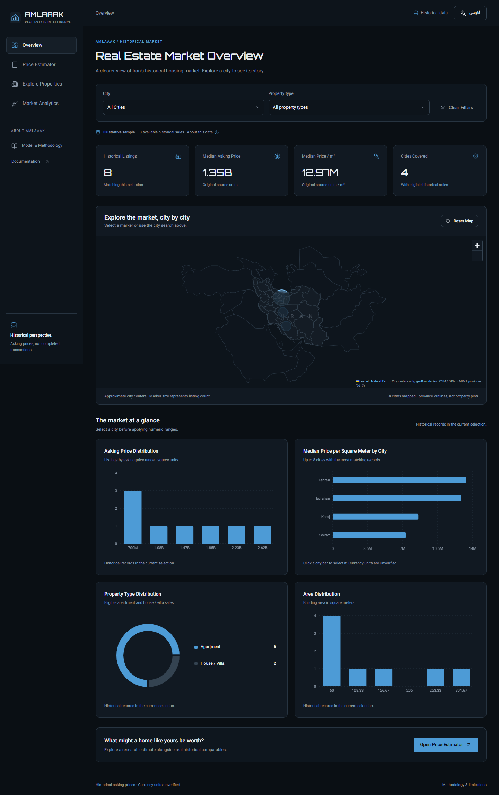
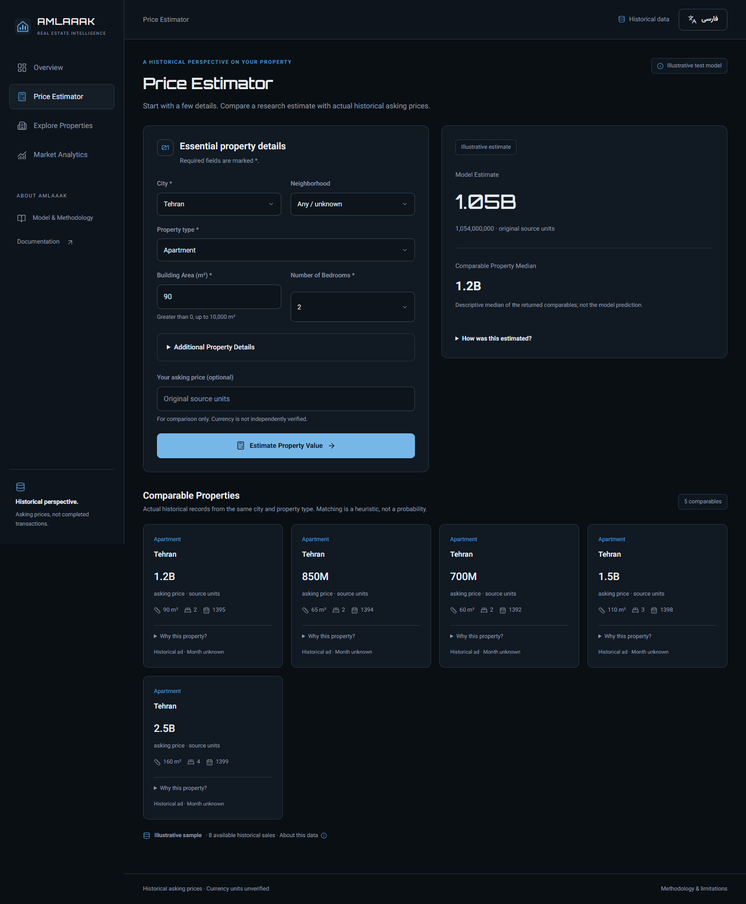
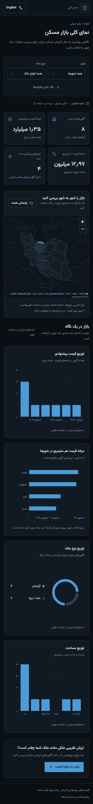

# AMLAAAK — Real Estate Intelligence

A bilingual English/Persian application for exploring Iran’s historical residential
asking prices and comparing a research price estimate with real historical properties.
The frontend is a full-page Next.js workspace; FastAPI serves verified, indexed data
and the existing fitted Random Forest through a server-side proxy.

The private prepared archive contains **420,813 eligible historical sales across 417
cities**, derived from **1,000,000 source records**. The prepared integration is verified
on the protected Preview workflow. This redesign lives on
**feature/simplified-dashboard-redesign**, based on Preview commit **f13e9e5**.
The redesigned interface is tested locally; it is not automatically promoted to Production.

## Product

| Page | Workflow |
| --- | --- |
| Overview · / | Four API-backed KPIs, a city-selectable Iran map and four focused charts. No estimation form or floating widgets. |
| Price Estimator · /predict | Essential property details, expandable optional attributes, a model estimate, separate comparable median and up to eight genuine historical records. |
| Explore Properties · /properties | City/neighborhood/type/range filters, server-side sorting and pagination, responsive records and provenance details. |
| Market Analytics · /analytics | City comparisons, price distributions, amenities and construction-year analysis. |
| Model & Methodology · /model | Secondary navigation: actual artifact metrics, training scope, features and limitations. |

The interface uses the supplied AttackPath palette: restrained blue accents,
flat surfaces and subtle borders. Orbitron is used for English display text,
Roboto for readable body text, and Vazirmatn for Persian. A lightweight persisted
language switch changes actual UI copy, number formatting and document direction.
The mobile navigation is an accessible drawer; the desktop sidebar has four primary routes.

### Actual interface

These screenshots show the implemented interface, captured with the explicitly labeled
illustrative QA fixture. Their eight-record counts and demonstration model results
are **not** Divar performance or market statistics. Real prepared-data integration is
tested separately; private listing screenshots are not published.

Persian mobile view

## Architecture and stack

- **Frontend:** Next.js App Router, React, TypeScript, TanStack Query, Zod, Radix UI,
  Lucide, Recharts, Leaflet/React Leaflet and Tailwind CSS with explicit design tokens.
- **Backend:** FastAPI, Pydantic, HTTPX and bounded worker-local caching.
- **Model:** scikit-learn RandomForestRegressor with its fitted preprocessing pipeline,
  NumPy, pandas and joblib; exact artifact-compatible versions are pinned.
- **Data:** immutable, private Hugging Face prepared release with checksummed gzip JSON
  serving indexes and Parquet research files. No deployed database or paid map service.
- **Verification:** pytest, Vitest, TypeScript, ESLint and Playwright.

~~~mermaid
flowchart LR
  Browser[English / Persian browser] --> Web[Next.js same-origin API proxy]
  Web -->|App bearer + Preview Trusted Sources OIDC| API[FastAPI]
  API -->|Backend-only HF_TOKEN| Data[Private pinned prepared archive]
  API --> Model[Approved fitted Random Forest]
  Model --> Registry[Pinned trusted model bundle]
  API --> Results[Statistics / records / estimate / comparables]
  Results --> Browser
~~~

### Repository structure

~~~text
apps/
  web/src/
    app/                    Routes, fonts, exact palette and server API proxy
    components/             Shell, localization, map, charts, explorer and estimator
    lib/                    Typed contracts, formatting and API client
  api/
    main.py                 Existing API routes and optional app authentication
    service/                Prepared provider, validation, ranking and inference
    prepared-release.json   Non-secret verified release identity and expected totals
notebooks/                  Self-contained Colab preparation notebook
scripts/                    Explicit preparation, verification and smoke commands
tests/                      Backend, preparation, privacy and model regression tests
docs/                       Deployment, evidence, methodology and UI acceptance
~~~

## Historical dataset

Original source: [Divar’s official real_estate_ads dataset](https://huggingface.co/datasets/divarofficial/real_estate_ads).
The prepared repository remains **private**:
[thevel0per/AMLAAAK-Real-Estate-Data](https://huggingface.co/datasets/thevel0per/AMLAAAK-Real-Estate-Data).

| Identity | Pinned value |
| --- | --- |
| Original source revision | e9446ee97b8e6eb9bd62bdfd7548f1bc8973be85 |
| Prepared revision | 8cc2a942d6d5d4b7cfa22e09a39d0223ff24019a |
| Prepared manifest SHA256 | 3f4dff6cd149c10c579371a8d33a151b64c72e11fa9aed00b132892198d72048 |
| Prepared sales / cities | 420,813 / 417 |
| Manifest-indexed files | 5,201 |

Eligibility includes fixed-price apartment and house/villa residential sales with
valid positive prices/areas. Rentals and sale prices are not mixed. Preparation
normalizes Persian/Arabic numerals, booleans and Solar Hijri years, removes personal
free text/contacts/exact coordinates, and deduplicates normalized safe fields.
The deduplication policy can merge different homes with identical recorded specifications.

The server verifies the trusted manifest and every fetched file’s checksum. Global
statistics use exact precomputed archive aggregates; property pages use sorted
global/city indexes. Numeric/text searches require a city. City construction is
bounded to 150,000 rows / 32 MiB compressed input and a 25-second budget, with at
most four chunk fetches in flight. Oversized/failed queries fail explicitly; there
is **no silent sample or prefix fallback** in prepared mode.

The browser receives aggregates, bounded chart series and paginated records—not the
whole archive. The map uses approximate public city centers and licensed province
geometry, not individual property pins or invented neighborhood boundaries. Not all
417 represented cities have map coordinates; every represented city remains searchable.
See [data format and limits](docs/PREPARED_DATA.md) and
[map attribution](apps/web/public/ATTRIBUTION.md).

Verification covers the pinned manifest, all inventory sizes and available Hub LFS
hashes, catalog consistency and bounded body samples. It does not claim an independent
reprocessing of every raw source row. [Evidence](docs/PREPARED_RELEASE_VERIFICATION.json).

## Price estimation and model scope

The approved model remains **267eff7c36f3** from
[AMLAAAK-Price-Predictor](https://huggingface.co/thevel0per/AMLAAAK-Price-Predictor)
at revision **89de24728daecdec3731e07475ab985c1efa87ad**. The model has not been retrained
for this redesign or for the larger searchable archive.

The verified original experiment used 862 eligible sales, 857 after deduplication,
with **414 training / 323 validation / 120 test records** and a chronological split.
Its held-out Random Forest MAE was 3,139,678,931.81, RMSE 7,929,988,797.03 and R² 0.166432,
in unverified original price units. These are limited-subset research results, not
accuracy established for every city or for today’s market.
[Exact experiment evidence](docs/REAL_DATA_EXPERIMENT.json).

The estimator:

1. Requires city, type, building area and bedrooms. Neighborhood is optional.
2. Accepts additional year/floor/amenity details as known values or unknown.
   Unknown is sent as null, not false or an invented property default. The unchanged
   fitted model imputer handles missing numeric details; this is disclosed in the UI.
3. Calls the existing valuation endpoint. Full-detail requests remain supported;
   the nullable advanced fields are a backward-compatible extension to the same contract.
4. Shows the model estimate separately from descriptive comparable statistics.
   Comparables are real same-city, same-type historical records ranked by explicit
   characteristics. Their displayed reasons are not confidence probabilities.
5. Shows a comparable median only when at least three records are returned.
   An optional user-entered asking price is compared arithmetically with the model
   estimate and comparable median. No unsupported price range or confidence interval
   is generated.

Model inference and comparable retrieval remain independent. Data outages can leave
an available model estimate with explicit missing comparable coverage; an unavailable
model can still return real comparable records.

## Local development

Verified runtime families: **Python 3.14** and **Node 24**.

~~~powershell
python -m venv .venv
.\.venv\Scripts\python -m pip install -r requirements-api-dev.txt
$env:AMLAAAK_DATA_MODE='illustrative'
.\.venv\Scripts\python -m uvicorn apps.api.main:app --host 127.0.0.1 --port 8000
~~~

In another terminal:

~~~powershell
cd apps/web
npm.cmd ci
$env:API_BASE_URL='http://127.0.0.1:8000'
npm.cmd run dev -- --port 3100
~~~

Open http://127.0.0.1:3100. This explicit offline mode serves the labeled ten-record
fixture (eight eligible sales). Models are not committed; inference remains unavailable
until a trusted bundle is configured. Tests can use temporary illustrative bundles.
For real private data and the approved model, follow
[the verified release setup](docs/PREPARED_RELEASE_DEPLOYMENT.md).
Uvicorn does not automatically load .env.example files.

### Environment responsibilities

| App | Variables |
| --- | --- |
| Web server only | API_BASE_URL; optional API_TOKEN matching backend app authentication |
| Backend data | AMLAAAK_DATA_MODE=prepared; AMLAAAK_PREPARED_DATA_REPO; AMLAAAK_PREPARED_DATA_REVISION; AMLAAAK_PREPARED_DATA_MANIFEST_SHA256 |
| Backend secret | HF_TOKEN: separate fine-grained private-dataset read token |
| Backend model | AMLAAAK_MODEL_REPO; AMLAAAK_MODEL_REVISION; AMLAAAK_MODEL_MANIFEST_SHA256; optional trusted local AMLAAAK_MODEL_DIR |
| Backend app auth | AMLAAAK_API_TOKEN, when enabled |
| Rollback only | AMLAAAK_DATA_MODE=huggingface; HF_MAX_RECORDS=300 |

Exact public pins are checked into apps/api/vercel.json and prepared-release.json.
Never expose tokens through NEXT_PUBLIC variables, browser code, logs, screenshots or Git.

## Preview and Production deployment

Two Vercel project roots remain **apps/api** and **apps/web**. The working protected
Preview integration uses Vercel Trusted Sources: the Next server forwards the
platform-issued x-vercel-oidc-token as x-vercel-trusted-oidc-idp-token only to a
configured Vercel backend. Optional app bearer authentication remains separate.
The proxy source and this mechanism are unchanged by the redesign. Deployment
Protection must remain enabled.

Deploy the feature branch to a **new Preview** for review. Deploy the compatible
backend first (nullable advanced inputs), then the frontend connected through its
server-side API_BASE_URL. Preserve existing Trusted Sources relationships, app
tokens, dataset/model pins and protection settings. Do not promote Production
automatically. [Redesign review steps](docs/UI_REDESIGN.md) and
[API deployment/rollback](docs/PREPARED_RELEASE_DEPLOYMENT.md) give exact commands.

The API and proxy retain 60-second function limits; the upstream proxy timeout is
55 seconds. Function bundle size, memory, cold starts, concurrency and HF availability
must be measured on the target Preview. Local acceptance is not a hosted SLA.

## Tests and verification

~~~powershell
.\.venv\Scripts\python -m pytest -q
.\.venv\Scripts\python -m pip check
~~~

From apps/web:

~~~powershell
npm.cmd run test
npm.cmd run typecheck
npm.cmd run lint
npm.cmd run build
npm.cmd run test:e2e
~~~

Default browser tests use an explicit illustrative API and the production frontend
build. Opt-in live suites must target the matching real backend. The prepared-release
browser flag is PREPARED_LIVE_E2E=1; legacy rollback data tests use LIVE_E2E=1.
No successful production responses are replaced by mocks. Unit tests mock external
boundaries, and explicit failure-state browser cases inject errors.

~~~powershell
.\.venv\Scripts\python scripts/verify_prepared_release.py --prompt-token
.\.venv\Scripts\python scripts/smoke_prepared_api.py --base-url http://127.0.0.1:8000
.\.venv\Scripts\python scripts/smoke_prepared_api.py --base-url http://127.0.0.1:3100
~~~

The scripts only read the pinned private archive and compute predictions. They
never download the complete dataset locally, upload data, retrain or deploy.

## Licensing, limitations and roadmap

Repository code is [MIT licensed](LICENSE). Source/derived database licensing is
separate: **ODbL 1.0**, attributed to Divar / divarofficial. Dataset Card YAML uses
the Hub identifier license: odbl; the versioned manifest retains odbl-1.0.
Preserve source attribution and license notices when using or sharing derived data.

Historical asking prices are not verified completed-sale transactions. Currency units
are not independently verified, so the UI does not relabel prices as toman or rial.
The model is research-oriented, trained on a small historical subset and not a sole
basis for financial decisions. There is no calibrated confidence interval, verified
current availability, complete municipal geometry or universal city-level validation.
Untranslated location slugs remain readable source names rather than invented translations.

Future work: broader independently evaluated training data, per-city validation,
more verified geographic coverage, calibrated uncertainty only after validation,
and further accessibility/performance measurement. None is claimed implemented.

Validation for this redesign: **124 backend tests**, **17 frontend unit tests**,
**12 offline browser tests**, and **1 authenticated real prepared-data browser test**
passed. Type checking, lint and the production build passed. See
[validation evidence](docs/VALIDATION.md) for skips, Windows test-temp workaround,
actual model/API checks and the remaining hosted Preview acceptance.
