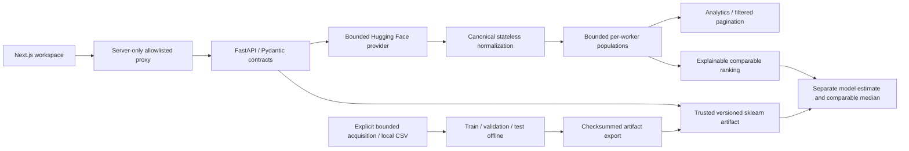

# Architecture

The application remains a monorepo with separately deployable apps/web (Next.js) and apps/api (FastAPI). No managed database, self-hosted database service, PostgreSQL, or MongoDB was introduced. Existing local SQLite ingestion remains an optional offline preparation tool, not writable Vercel persistence.

The source provider performs lazy /splits discovery and bounded /rows retrieval. /filter is capability-probed, not assumed functional: actual verification failed, so the response explicitly labels local filtering within an unfiltered prefix. Source revisions are checked across pages. Standard-library normalization is shared by source serving and the existing pandas training adapter, preventing incompatible numeral/year/boolean semantics. No full data acquisition occurs on startup, builds or HTTP requests.

A Repository adapter preserves illustrative/snapshot mode. The live provider returns the same normalized Property contract and population operations. Existing analytics functions remain usable. All population counts and sorting have explicit scope; no first-page count is promoted to a whole-city statistic. Cache bounds, query support and limitations are detailed in DATA_PROVIDER.md.

POST /valuation retrieves same-city/type candidates, ranks them by transparent feature/period similarity, and combines them with an independently computed model estimate. Missing model and missing candidate-source states are separate. Matching explanations, historical period and revision/row identities are returned, with no invented active listings, URLs, photos or addresses.

The original fixture trainer remains a reproducible smoke path. amlaaak.real_training adds conservative specification grouping, chronological whole-month train/validation/test splits when dates permit, training-only imputation/encoding, validation selection between two forest leaf sizes, median-baseline test comparison and minimum-count per-city metrics. Neighborhood is not silently added as a model feature; no unverified feature-improvement claim is made. Artifact export requires matching source hash and compatible feature contract.

Inference loads once per worker from an explicit local directory or operator-approved revision-pinned model repository. Hashes and exact ML package versions are verified. No model training takes place in API requests. Unavailable artifacts do not generate artificial predictions. Optional remote provisioning uses bounded temporary files and requires an independently trusted manifest hash; arbitrary joblib is never considered safe merely because it can be downloaded.

The Next.js UI uses shared filters, typed Zod responses, TanStack Query and Radix picker portals. Backend URLs/HF credentials/tokens remain server-only. Browser requests call only the same-origin Next proxy. The contextual insights panel computes descriptive summaries; no LLM is simulated. Next/font/google supplies global Roboto and Persian Vazirmatn fallback. Lucide icons use consistent styling. Original roof/building/data-bar SVG assets identify the application at header/sidebar/mobile/favicon sizes.

Map geometry includes original Natural Earth countries plus geoBoundaries IRN ADM1 province-level features. These are explicitly not municipal city boundaries. Approximate public city centers and the selected province outline coordinate with API city filters. Province hover/popups describe only represented mapped cities, never full-province totals. Geometry is lazy-loaded; source attribution/licensing and the metadata/feature-count discrepancy are retained. No private listing coordinates or paid map key are used.

Production limitations remain: bounded historical coverage, failed upstream remote filtering during verification, unverified currency units, modest held-out model results, no calibrated uncertainty, sparse per-city evaluation, partial city-center coverage, unverified municipal boundaries, and untested hosted ML bundle/cold starts. For larger analyses, use explicit offline preparation or expand a bounded HF strategy with truthful coverage, not an unrequested database service.

## Optional complete prepared archive

The Colab-only preparation modules use pinned source CSV streaming (or direct
Parquet batches), safe normalization, disk-backed deduplication and exact aggregate
generation. A manually approved upload produces an immutable private HF dataset
commit and trusted manifest hash. The `PreparedDataProvider` verifies those artifacts
and uses precomputed global/city statistics, sorted page chunks, geographic partition
indexes and bounded private-file caching. Runtime imports no preparation/Datasets/
PyArrow dependencies. Existing API paths and Next server-side proxy remain; UI changes
only clarify archive coverage. Model artifacts, training, version and inference stay
separate and unchanged. See [PREPARED_DATA.md](PREPARED_DATA.md) for exact memory/query
budgets and [the beginner rollout guide](PREPARED_DATA_QUICKSTART.md).
