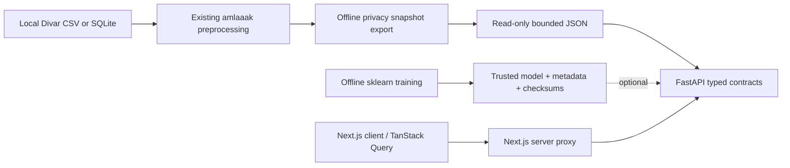

# Dashboard architecture

The user-provided `amlak dashboard.png` was inspected before implementation. Its compact dark workspace, map beneath floating analytical cards, cyan/violet accents, elevated borders and separate right insights rail informed this adaptation. It remains a local reference, not an application asset or a repository screenshot.

## Boundaries

`amlaaak/` remains the training and preprocessing library. `scripts/prepare_dashboard.py` reuses its eligibility rules and numeric parsing. It emits only normalized structured inputs, target, computed price/m², content-derived IDs and explicit provenance. Descriptions, titles, contact data, neighborhood and precise coordinates are excluded. Export is local, never automatic during build or requests, and refuses existing output paths. The included `apps/api/assets/sample.json` is a reproducible representation of the existing illustrative fixture, retaining eight distinct eligible sales.

`apps/api/` is independently deployable: the default runtime needs FastAPI/Pydantic and standard-library analytics, not pandas/scikit-learn. The snapshot is validated once per process/cold start. Filters, aggregate calculations, sort and pagination run on the server. Browser responses contain aggregates, a maximum 200 scatter records, or a maximum 100 table records per page. The exporter rejects snapshots above 50,000 records; the service rejects files above 50 MB. This bounded snapshot design needs no paid database or writable persistent storage. For a larger deployment, implement a SQL-backed repository adapter with indexed server-side aggregation; the current adapter scans in memory and is not a full-dataset serving solution.

`apps/web/` is a Next.js App Router application. Shell, shared filters, data state and pages use client components, with a server-only allowlisted API proxy. Zod parses every successful backend response used by the UI. Pydantic validates request ranges and response contracts; the tests exercise both. Backend origin and optional bearer token never use a `NEXT_PUBLIC_` variable and are not sent to client bundles. CORS is intentionally not enabled; browsers call the same-origin proxy. This does not replace per-user authentication if private data is added later.

The map is a client-only React Leaflet 5 component using local public-domain Natural Earth country boundaries. It makes no tile/API requests and needs no key. City markers use a small documented dictionary of approximate public centers; unmapped cities remain in analytics and tables. Country fill is context, not an invented choropleth. Marker size reflects eligible count. Filters can be changed through the toolbar, chart bins, city bars/bubbles, type donut, numeric forms and reset controls. Desktop floating widgets support pointer dragging, arrow-key nudging, Home reset and native corner resizing. Layout reset remounts widgets. On mobile they stack and disable drag/resize. Layout changes are session-local, not persisted.

## Inference and provenance

Inference is disabled unless `AMLAAAK_MODEL_DIR` points to a trusted bundle containing `model.joblib`, `metadata.json`, and `manifest.json`. Export checks the model's training source SHA against the snapshot source, validates feature names, copies an existing artifact and writes checksums and kind. No model is fitted during API startup, requests or frontend builds.

The service checks checksums and exact numpy/pandas/scikit-learn/joblib versions before loading joblib. Checksums detect corruption, **not malicious substitution**: operators must trust the artifact source, since pickle-compatible loading can execute code. A load failure fails closed with unavailable status and server logging. The checksummed model hash prefix is the public model version. The form submits already normalized, validated features, matching the existing fitted column contract without requiring a target. Unknown cities are accepted by the one-hot encoder but explicitly lack a learned city effect. Input bounds are guardrails rather than proof of training-domain support.

Illustrative bundles remain labeled `illustrative` in status, metrics and predictions. There is no synthetic fallback prediction, fabricated confidence band, LLM assistant, residual series or live-market label. The right rail computes descriptive observations from current API summaries. Model metrics are global artifact metadata and do not change with dashboard filters.

## Failure and operational behavior

- Missing/bad snapshot: health reports `degraded`; analytics return 503.
- Missing/bad model: analytics continue; prediction returns 503; metrics scores are null.
- Invalid filters/prediction: consistent 422 error envelope. No raw input data is logged.
- Backend unreachable/unconfigured: the Next proxy returns an explicit JSON error. The UI offers retry/empty states.
- Optional API bearer authentication applies to all routes except health, including OpenAPI. Set the matching web server token.
- No persistence writes, training, arbitrary URL proxying, user file uploads, or secrets in browser storage.

The API is designed for a public research demo. Production work still needs load/size verification on the target host, authentication where appropriate, edge rate limiting and monitoring, a vetted real-data release and stronger evaluation.
