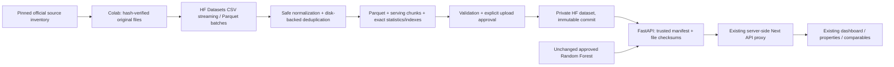

# Prepared historical archive: design and verification

## Scope and status

This adds a manually activated `AMLAAAK_DATA_MODE=prepared` adapter. The existing
`huggingface`, `illustrative` and `snapshot` modes remain. Default behavior stays
`huggingface`; the data mode is deliberately absent from `apps/api/vercel.json` so
backend dashboard variables can select prepared mode. Approved model settings are
unchanged. No model retraining, dataset upload, push or deployment is performed here.

The pinned original source is `divarofficial/real_estate_ads` at
`e9446ee97b8e6eb9bd62bdfd7548f1bc8973be85`. Actual Hub metadata/tree checks found **one
source CSV**, `real_estate_ads.csv`, 780,721,338 bytes, LFS SHA-256
`e5760fe1325a195e6682c371457bfecd51d255c518756e3cbea234b8163a801f`.
The source and prepared Dataset Card YAML use the Hub identifier `odbl`; the versioned
manifest retains `odbl-1.0`. Both describe ODbL 1.0 and retain Divar attribution. The Dataset Server's converted Parquet
branch is not substituted for the immutable original source commit.

The user completed Colab preparation and uploaded the private archive. Authenticated
verification of the exact supplied revision/hash passed, including all 5,201 inventory
sizes, 5,200 Hub LFS hashes, the direct catalog hash and bounded body samples. Published
source-processing counts and every global/city/category index total agree. The agent
has not downloaded/reprocessed the full raw source or all archive bodies locally.
Actual local FastAPI and Next proxy/browser checks served 420,813 sales and 417 cities
with genuine comparables and the unchanged model. **Hosted prepared Production is
not activated by the agent.** See [release deployment and precise verification scope](PREPARED_RELEASE_DEPLOYMENT.md).

## Data flow



## Notebook and preparation

`notebooks/prepare_divar_dataset.ipynb` is an actual self-contained notebook, generated
by `scripts/build_prepared_notebook.py`. It embeds the reviewed normalization, schema,
format, preparation and upload modules, so opening it through Colab's **Upload notebook**
requires neither a prior Git push nor copying code. Tests check synchronization,
compile every code cell, execute its embedded preparation against synthetic input,
and exercise its unapproved-upload stop. Colab itself has not been executed here.

Install-only preparation dependencies are in `requirements-preparation.txt`, included
in development requirements. They are **not** added to Vercel runtime requirements.
The runtime uses existing HTTPX, Pydantic and Python gzip/JSON; it does not require
Datasets, PyArrow, SQLite hosting, a database service or all source records in memory.

The notebook compares two pinned Hub inventories, verifies every LFS source hash,
checks schema, and makes an independent bounded streaming count before normalization.
All expected CSV/Parquet partitions must be present and reach readable EOF with matching
counts. CSV is read using HF Datasets streaming with string feature types; Parquet uses
PyArrow record batches. No source row limit exists. Colab needs at least 8 GiB free disk
and 3 GiB RAM; real resource use/time still need measurement. Source files and temporary
staging remain only in Colab; they are never uploaded.

Only positive, finite fixed-price residential apartment and house/villa **sales** are
eligible. Rentals are separately counted and excluded, never relabeled as sales.
Missing features remain missing; no target imputation occurs. All valid observed
city/neighborhood slugs are supported without a city allowlist. Invalid city rows and
invalid neighborhood values are counted. The safe allowlist excludes titles,
descriptions, phones, contact names, ad tokens, listing URLs and precise coordinates.
Only advertisement **month**, public geographic slugs, structured attributes and
historical prices survive. This minimizes personal data; it is not a claim of formal
anonymity or permission for arbitrary downstream redistribution.

Deduplication uses identical normalized safe fields, including city, neighborhood and
month, with a deterministic hash ID. A truncated-hash collision stops processing.
Different homes can have identical specifications and be merged; this limitation is
recorded. Unnecessary personal IDs are not retained to disambiguate them. Counts report
source rows, pre-dedup eligible rows, duplicates, rentals and other exclusions.

Ephemeral SQLite stages safe records on disk (8 MB cache, disk temp sorting). Exact
summary statistics, medians, histograms and neighborhood lists are generated for the
archive and each city/category. Processing batches are 1,024 rows; output chunks at
most 2,000 rows. There is no deployed SQLite dependency.

## Versioned format

All uploaded paths live under `prepared/`, except the root ODbL attribution README:

- `manifest.json`: schema version 1, source commit/file hashes, expected/processed counts,
  explicit completeness flag, exclusions, dedup policy, and SHA-256/byte/row inventory.
- `catalog.json`: exact archive/city/category statistics, city/neighborhood indexes,
  sorted page indexes and observed historical period. Scatter charts use at most 20
  display points selected by deterministic ID per group; histogram/count statistics remain exact.
- `data/<city>/<category>/<chunk>.parquet`: Zstandard-compressed structured research data.
- Matching `.json.gz` files: independently hashed serving chunks for numeric/search
  filtering and comparable ranking, without requiring a Parquet runtime on Vercel.
- `views/.../*.json.gz`: global and city sorted chunks for four supported table sorts.
  Category counts permit exact category pagination without reading every row.
- `lookup/<id-prefix>.json.gz`: direct ID-to-partition indexes for property details.

Serving indexes duplicate some safe fields to trade compact compressed storage for
bounded requests. This is intentional; it is not additional observations. No raw file,
staging database, token or trained model is in the upload inventory. Every output hash,
row count, schema and structured-field allowlist is revalidated before upload.

The final upload requires both exact typed confirmation and license acknowledgement,
checks the existing target's identity/private visibility, and uses bounded commits
(at most 200 operations / 32 MiB file contents per data batch) with `parent_commit`
to reject concurrent changes. The manifest and attribution card are published together
in the final commit only. Failed intermediate uploads do not produce verified output
values; existing production references remain pinned to their previous commit. It never creates repositories, changes
visibility, deletes files or touches the model. Same-named prepared paths/README are
updated; unused older files may remain in repository history/current tree but are not
referenced by the new manifest. Every uploaded file and attribution card is downloaded
again at the immutable returned commit and SHA-256-verified before printing results.
This extra read-back takes time/disk but prevents declaring an unverified upload ready.

ODbL applies to the derived database, separately from the repository's MIT code.
Private hosting does not cancel source license obligations. The notebook shows the
source card/license and proposed attribution before requesting approval.

## Serving and query limits

Required backend-only variables:

```dotenv
AMLAAAK_DATA_MODE=prepared
AMLAAAK_PREPARED_DATA_REPO=thevel0per/AMLAAAK-Real-Estate-Data
AMLAAAK_PREPARED_DATA_REVISION=<actual notebook dataset commit>
AMLAAAK_PREPARED_DATA_MANIFEST_SHA256=<actual notebook manifest hash>
HF_TOKEN=<private dataset read token>
```

The provider pins every fetch to that immutable commit, verifies the trusted manifest
then every fetched file's size/hash before parsing. It never calls `/rows`, `/filter`
or the Dataset Server, and never falls back to illustrative or prefix data on errors.
Credentials are sent only server-side to Hugging Face; HTTPX strips Authorization on
cross-origin redirects. Signed private-file request URLs are not logged by HTTPX.

Global and city/category summaries, city statistics, distributions and facets read only
the manifest/catalog. Global/city property pagination reads indexed sorted chunks;
details read one ID index and its partition. No global request loads a million records.
Histograms/medians use the full prepared query population, not the displayed scatter.

Combined neighborhood/numeric/year/bedroom/text filters require a **city**. These and
comparables load only matching city/category partitions; neighborhood queries prune
unrelated chunks. Request guards allow at most **150,000 rows / 32 MiB compressed**
of city partitions and a **25-second loading budget**. Narrow category/neighborhood if
the guard is exceeded. A broad query is rejected with 503 rather than returned with a
false full-coverage claim. This archive adapter is not an unrestricted database query
engine; very large cities/concurrency may eventually require a dedicated query service.

Files are capped at 32 MiB, manifest at 8 MiB, decompressed chunks at 8 MiB / 2,000 rows.
Verified serialized file cache is bounded to **24 MiB / 32 entries**, TTL 120 seconds, per
worker. Four file fetches can run concurrently, duplicate fetches share a Future, and
one guarded city/category population is cached for 120 seconds. Matching heavy
queries share that population; waiting/loading/validation use the same 25-second budget. The catalog, parsed city population and in-flight objects add memory beyond file-cache bytes.
Private immutable source outages return visible 503 errors on analytics; valuation model
inference can still respond with zero comparable coverage even if dataset configuration
could not initialize. Health reports lazy readiness/check state.
Checksums, decompression, schema errors, failed authentication and budget failures do
not silently produce successful empty data. A genuinely absent city can return a
truthful empty result.

Coverage distinguishes original source rows processed, total prepared available sales,
matching query rows, current request reads, and verified source completeness. Exhaustive
means exhaustive **within the prepared archive/query**, not current housing inventory,
active ads, or guaranteed market representativeness. Searchable archive growth does
not alter model training metadata, version, evaluation metrics or predictions.

Existing API paths and server-side `API_BASE_URL` are unchanged. UI changes are limited
to archive count/coverage wording; the design and pages remain. The provider is not
automatically selected and no private dataset revision/hash is committed as ready.

## Validation commands

```powershell
.\.venv\Scripts\python -m pip install -r requirements-api-dev.txt
.\.venv\Scripts\python -m pytest -q
.\.venv\Scripts\python scripts/build_prepared_notebook.py
```

Tests cover synthetic Parquet and the actual source CSV format, full counts, privacy,
deduplication, source inventory/hash errors, notebook embedded execution, upload
approval/private-target guards, mocked bounded upload/read-back, manifest/chunk corruption,
all four global sorts in both directions, category pagination, city/neighborhood/price/area
filters, direct details, comparable ranking, cache/budget limits, credential stripping,
outages and missing configuration. Existing model tests remain.

Frontend checks: `npm.cmd run test`, `npm.cmd run typecheck`, `npm.cmd run lint`,
`npm.cmd run build`. `PREPARED_E2E=1` enables the prepared browser test against the
explicit synthetic 18-record QA archive server; it is **not** a hosted/private-network
success claim. Default browser tests continue using the illustrative fixture.

Rollout, exact beginner steps, hosted acceptance and rollback are in
[PREPARED_DATA_QUICKSTART.md](PREPARED_DATA_QUICKSTART.md).
